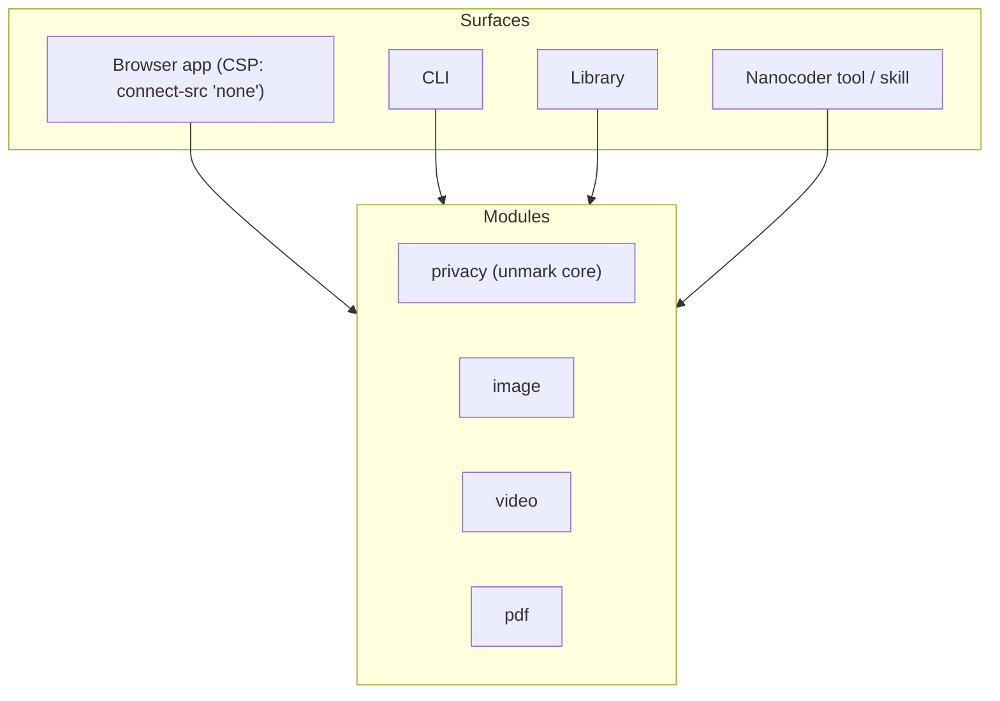

# Nanofile (working title)

Most everyday file work is done by uploading the file to a website. Shrinking a photo for a form, compressing a video for a chat, merging two PDFs, or making a scanned ID small enough for a portal usually means handing the file to a server run by someone else. The files people do this with are often the most personal ones they have: identity documents, bank statements, contracts, medical letters, photos of their children.

The native tools that do all of this locally (FFmpeg, ImageMagick, qpdf, Ghostscript, ExifTool) are excellent and free, but they are command-line programs with large option surfaces, and most people will never use them. So the upload site wins by default.

This whitepaper proposes **Nanofile**, a local-first toolkit that does the common file tasks on the user's own machine, in a browser tab, a CLI, or as a library an agent can call. It has four modules:

- **Privacy.** Inspect and remove identifying metadata, provenance manifests, and invisible characters.
- **Image.** Compress, resize, and convert images.
- **Video.** Compress and trim video.
- **PDF.** Merge, split, reorder, rotate, and compress PDFs.

The privacy module already exists. It is [`unmark`](https://github.com/Dhirenderchoudhary/unmarkk), built by the proposer and published to npm as `@unmarkk/core` and `@unmarkk/cli`. This proposal is to grow it into the toolkit above under the collective, rather than to start from nothing.

The name, module list, and scope below are open for review.

## Problem

### The upload is the privacy leak

An online compressor or PDF tool has to receive the whole file to do its job. Whatever its privacy policy says, the user has no way to check what happens to the file afterwards. That is acceptable for a meme. It is not acceptable for a passport scan, and people routinely do it with passport scans because the portal they are applying through has a 200 KB upload limit and they have no other tool to hand.

### Files also carry what the user cannot see

A photo from a phone carries GPS coordinates, the camera model and serial number, and the capture time. A Word document carries its author, company, and editing time. A PDF exported from a design tool can carry a local file path. None of this is visible when looking at the file, and all of it travels with it. Compressing or converting a file does not reliably remove it, and some tools copy it across on purpose.

### Agents send files as they are

Nanocoder accepts images dropped or pasted into the prompt and forwards them to vision-capable models. The file is read and base64-encoded unchanged ([`source/utils/clipboard-image.ts`](https://github.com/Nano-Collective/nanocoder/blob/main/source/utils/clipboard-image.ts), `readFileSync(path).toString('base64')`). A phone JPEG dragged in to ask about a layout bug goes to the provider with its EXIF block intact, GPS included, and at full resolution even when the model would downscale it anyway.

This is not a Nanocoder bug. No model SDK strips metadata or resizes images. The collective already publishes [`prompt-scrub`](/prompt-scrub/docs) for the text of a prompt. Nothing yet covers the files.

## Intended audience

- **People who use upload sites today** for compression and PDF work, and would use a local tool if it were as easy. The browser app is aimed at them.
- **Nanocoder users** who attach screenshots, photos, and documents to cloud models.
- **Developers of local-first tools**, inside the collective and outside it, who need one well-tested library for "make this file smaller" or "remove what this file says about me" without shipping native binaries.
- **CLI users** who know FFmpeg and qpdf exist but want sensible defaults for the twenty tasks they actually do.

## Principles

- **Local-first.** Files are processed on the user's machine. No file, hash, filename, or report is sent anywhere.
- **The engine cannot perform I/O.** Each module's core takes bytes and options and returns bytes and a report. It has no file system access and no network client. `unmark` already works this way, and it is the property that lets the same engine run in a browser, a CLI, and an agent.
- **The browser app is blocked from the network by the browser.** The page sets `connect-src 'none'` in its Content-Security-Policy, so any request it could attempt is refused. A user can open the network tab and watch nothing happen. `unmark`'s web app ships this today.
- **Inspect before you trust.** Every operation can report what it will do before it does it: what metadata was found, what size a compression setting will produce, which pages a split will create.
- **Fail closed.** An unsupported, encrypted, or malformed file is refused with a reason, never passed through unchanged.
- **Verify the output.** After a privacy clean the output is inspected again. After compression the output is decoded to confirm it opens. A result only counts as done when that check passes.
- **Never modify in place by default.** The original is left untouched.
- **Honest capabilities.** Each module's documentation leads with what it does not do. A tool listed in the interface is a tool that works.

## Threat model

### In scope

- **Disclosure through upload.** Using a third-party server to process a file. Removed entirely by doing the work locally.
- **Disclosure through metadata.** GPS, device identifiers, author and company names, local paths, timestamps, edit history, and earlier PDF revisions kept by incremental saves.
- **Provenance markers.** C2PA manifests, generator tags, and invisible Unicode characters, which `unmark` already detects and removes. These are reported separately from identifying metadata, because "made by a model" and "made by me, here" are different concerns.

### Out of scope

- **What the file visibly shows.** A face, a street sign, or a document whose text names the user. Nanofile does not redact or blur.
- **Pixel-domain and statistical watermarks.** Marks embedded in image data or in word choice survive metadata removal. `unmark` already says so when it finds nothing.
- **Network and account identity.** When a cleaned file is then sent to a cloud model, the provider still sees the user's key and IP address.
- **Untrusted input sanitisation.** Nanofile is not designed to make a malicious PDF or video safe to open.

## Proposed approach

### One contract, four modules

Every operation in every module has the same shape:

```ts
type Operation<O> = (input: Uint8Array, options: O) => Promise<{
  output: Uint8Array;
  report: Report;
}>;
```

Modules are separate packages so a consumer that only needs metadata removal does not download a video encoder.



| Module | Operations | Engine | Runs without native binaries |
| --- | --- | --- | --- |
| Privacy | inspect, clean, scan | `@unmarkk/core`, zero dependencies, direct parsers for JPEG, PNG, WebP, PDF, DOCX, ODT, SVG, HTML, Markdown | Yes, shipped |
| Image | compress, resize, convert (JPEG, PNG, WebP, AVIF), target a file size | WebAssembly builds of established codecs (MozJPEG, libwebp, libavif, oxipng) | Yes |
| PDF | merge, split, reorder, rotate, structural compression, image downsampling inside the PDF, page previews | `pdf-lib` for structure, PDF.js for rendering, the image module for embedded images | Yes |
| Video | compress, trim, resize, strip audio, convert to MP4 or WebM | FFmpeg: native binary on the CLI when installed, `ffmpeg.wasm` in the browser, WebCodecs where supported | Partly. See Open risks |

### Pipelines

Real tasks combine modules. "Make this scan small enough for the portal and remove what it says about me" is image compression followed by a privacy clean. Order matters: re-encoding can carry metadata across, so the privacy step always runs last and its verify pass runs on the final bytes.

```bash
# Compress a photo to under 200 KB, then strip metadata. Writes passport.out.jpg.
nanofile image compress passport.jpg --max-size 200kb --then privacy clean

# Merge, compress, and clean three PDFs into one.
nanofile pdf merge a.pdf b.pdf c.pdf --compress --then privacy clean -o application.pdf

# Shrink a screen recording for a bug report.
nanofile video compress recording.mov --target 25mb
```

The `--then` chaining is a sketch. The command surface is an open question.

### Surfaces

- **Browser app.** A static page that works offline after first load and makes no network requests. Drop files, pick a task, download the result. This is the surface that replaces the upload site.
- **CLI.** One `nanofile` command with subcommands per module. Exit codes are meant for pipelines, following `unmark`: `0` nothing to do, `1` work done or findings reported, `2` bad input.
- **Library.** The packages above, usable in Node and the browser.
- **Nanocoder.** A tool or skill that lets the agent compress, convert, and clean files in the user's project, and an optional step in Nanocoder's attachment path that resizes images to what the model will accept and removes their metadata before encoding. Whether that step exists, and whether it is on by default, is a decision for Nanocoder's maintainers.

### What unmark brings

`unmark` is the privacy module as it stands today:

- `@unmarkk/core` 1.0.5 on npm, MIT, zero runtime dependencies, runs in Node 20.11+ and the browser.
- `@unmarkk/cli` (`inspect`, `clean`, `scan`, `audit-site`, `rewrite`), `@unmarkk/server` (a loopback-only HTTP API), and a browser app with `connect-src 'none'`.
- PDF cleaning that re-serialises the document from its object graph, so removed objects are absent from the output, not merely unreferenced.
- Documented limits: encrypted PDFs and legacy Office formats are refused, and statistical watermarks are reported as out of reach.

Its contract, I/O-free engine, and honest-limits documentation are the template for the other three modules.

## v1 scope

The modules have very different difficulty, so v1 is staged.

**v1.0**

- Privacy module, moved from `unmark` under the collective's conventions.
- Image module: compress, resize, convert, and target a file size, for JPEG, PNG, WebP, and AVIF.
- PDF module: merge, split, reorder, rotate, and structural compression.
- Browser app and CLI covering the above, with pipelines between them.
- A public test corpus of real files with expected results, run in CI.

**v1.1**

- PDF image downsampling (the part of PDF compression that actually shrinks scans).
- Video module.
- The Nanocoder integration.

### v1 success picture

- A user can compress a phone photo to a portal's size limit and remove its location in the browser app, with the network tab showing no requests.
- Every file in the corpus comes out of the privacy module with zero findings on re-inspection, and out of the image and PDF modules in a form that opens and renders correctly.
- Image compression output is within a few percent of the same codec run natively at the same settings.
- At least one tool other than Nanofile's own surfaces uses a module as a library.

## What it is not

- **Not a document editor.** No text editing inside PDFs, no annotation, no forms.
- **Not an anonymiser.** A clean file can still identify its author through what it shows or says.
- **Not a replacement for FFmpeg, qpdf, or ExifTool.** People who already use them should keep doing so. Nanofile wraps established codecs with defaults and a local interface; it does not reimplement them.
- **Not a cloud service.** There is no hosted processing tier, now or later.

## Composition with other collective projects

- **`prompt-scrub`** covers the text of a prompt; the privacy module covers the files attached to it. They ship independently.
- **Nanocoder** is the first intended agent consumer, through a file tool and its image attachment path.
- **[Nanocoder Desktop](/collective/whitepapers/nanocoder-desktop)** handles files dragged into chats and could call the same packages.
- **[Sentinel](/sentinel/docs)** (alpha) audits repositories. A rule pack that flags committed images carrying GPS data, using the privacy module's `scan` as the detector, is a possible future addition, not part of v1.

## Alternatives considered

- **A thin interface over native FFmpeg, ImageMagick, and qpdf.** Best output and fastest. Rejected as the only path because it cannot run in a browser tab and requires users to install binaries, which is exactly the step that sends them to upload sites. Kept as the preferred video backend on the CLI.
- **Self-hosted server tools** such as Stirling-PDF. They keep files off third-party servers, but the user has to run a server. Nanofile's browser app needs nothing but the page.
- **Squoosh-style single-purpose apps.** Squoosh showed that WebAssembly codecs in a browser tab produce good images locally. A collection of single-purpose apps does not give pipelines, a CLI, or a library an agent can call.
- **Keep `unmark` separate and build the rest as a new project.** Possible, and `unmark` could come in on its own through [Bringing an Existing Project](/collective/projects/bringing-an-existing-project). Rejected as the main proposal because the I/O-free contract and the browser security model are the valuable part, and they should be shared from the start rather than retrofitted.
- **Privacy only.** The narrowest useful scope. Rejected because the privacy gain from local processing comes mostly from replacing the upload sites, and people use those for compression and PDF work, not for metadata removal.

## Competitive landscape

- **Upload-based tools** (online PDF suites, image compressors, video compressors) are the default for most people. They are easy and capable. They require uploading the file.
- **Native tools** (FFmpeg, HandBrake, ImageMagick, qpdf, Ghostscript, ExifTool, mat2) are local and excellent. Most need the command line or a separate install per task.
- **Browser-local tools** such as Squoosh prove the approach works. Nanofile's difference is one I/O-free engine shared across a browser, a CLI, and agents, with metadata removal built into every pipeline.

## Open risks

- **Video in the browser is the hardest part.** `ffmpeg.wasm` is much slower than native FFmpeg, and 32-bit WebAssembly limits how much memory a tab can use, which caps practical file sizes. WebCodecs is faster but browser support and container handling vary. Video may end up CLI-first, with a browser size limit stated up front.
- **Codec licensing.** The image codecs listed are under permissive licences. Common FFmpeg builds include GPL components (libx264 is GPL), which conflicts with the collective's MIT default. The video module needs either an LGPL build with royalty-free codecs (VP9, AV1) or a clear separation that keeps GPL code out of the MIT packages. This needs to be settled before any video code lands.
- **PDF compression expectations.** Structural rewriting shrinks some PDFs and not others. Real gains on scans come from downsampling embedded images, which is significant work. Until v1.1 the interface must say clearly when a file did not shrink.
- **Bundle size.** WebAssembly codecs are several megabytes each. The browser app must load a module only when its task is chosen.
- **Scope creep.** "File tools" has no natural edge. The module list is the edge. A new module needs its own review.
- **Maintenance.** Four modules is more than one person. The proposer maintains `unmark` and commits to the privacy and image modules; video and PDF need co-maintainers.

## Open questions

- **Bring `unmark` first, or all at once?** `unmark` could move in through the existing-project path while the toolkit is reviewed, or move in as part of this proposal.
- **Package names.** `@nanocollective/nanofile-privacy` and siblings, or keep `@unmarkk/*` names for continuity during migration?
- **Video backend.** CLI-only in v1.1, browser with a size cap, or WebCodecs-first?
- **Nanocoder default.** Should Nanocoder clean and resize attachments by default, with a notice, or leave it to a setting? The proposer leans towards on by default.
- **Which of `unmark`'s extra commands come across.** `audit-site` and `rewrite` (which can call a local Ollama model) fit the privacy theme but widen the scope.
- **Name.** `Nanofile` is a placeholder.

## Next steps

1. Open a Stage 0 conversation on the docs repository to confirm the four-module scope and the `unmark` route.
2. Extract `unmark`'s operation contract and browser security model into a shared base package.
3. Build the image module on that base, with the corpus, and publish benchmark results against native codecs.
4. Prototype the video module far enough to settle the licensing and browser-size questions.
5. Bring results back to this document before the build decision.
